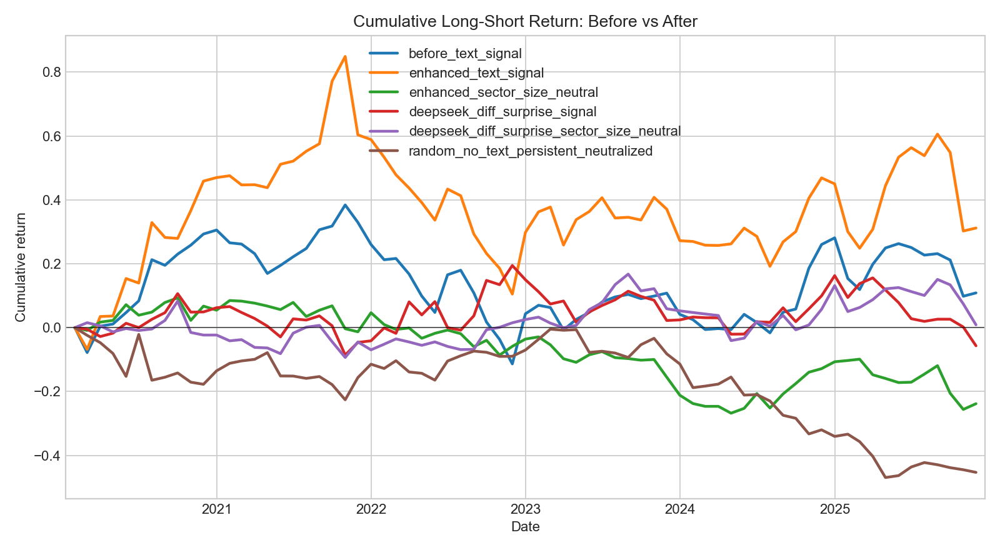
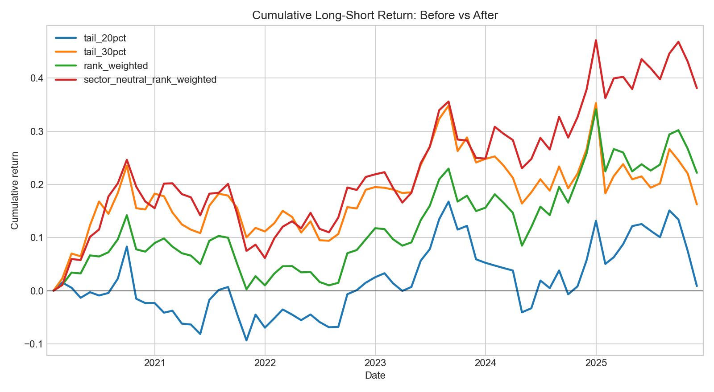

# LLM Equity Signal Research


Research prototype for testing whether SEC 10-K Item 1A Risk Factors can be converted into useful cross-sectional equity signals with deterministic text features and LLM-based extraction.

The project is deliberately built as a research pipeline rather than a trading system: text is aligned by filing date, converted into monthly point-in-time signals, evaluated against 1-month forward returns, and compared with random no-text baselines.

## What This Project Tests

Main research question:

```text
Can structured signals extracted from company risk disclosures forecast short-horizon relative stock returns?
```

The core workflow is:

```text
SEC 10-K Item 1A text
        -> deterministic or LLM-derived signal
        -> point-in-time monthly signal matrix
        -> cross-sectional long-short backtest
        -> IC, Sharpe, drawdown, cumulative return, random baseline comparison
```

The project has gone through seven research rounds, from transparent dictionary signals to DeepSeek LLM prompts that score year-over-year filing changes.

## Current Status

Latest main result: **Round 7 Item 1A repair rerun**.

- Universe: 211 SEC 10-K Item 1A filings, 42 large-cap US tickers.
- Filing window: 2020-2025 current filings, with prior 10-K context for YoY comparisons.
- Backtest: monthly signal alignment, 1-month forward returns, long top quintile / short bottom quintile.
- Latest evaluation: 71 common signal months, 70 backtest periods, fractional tie handling, persistent sector/size-neutralized random baseline.

The parser repair materially changed the research conclusion. The old Round 6 result is now treated as stale because 122 of 293 raw Item 1A rows were re-extracted and 98 of 211 YoY pairs had at least one side of the comparison change. Read on headline Sharpe alone the result looks worse, but the verified evidence points the other way:

- The deterministic `enhanced_sector_size_neutral` benchmark — a pure text function with no LLM — flipped from +0.48 to -0.33 Sharpe purely from the text fix, which proves that tail-portfolio Sharpe in this 42-ticker universe is dominated by noise.
- On the cleaner text, the LLM signal's rank IC rose to 2.88% (91st percentile, empirical p=0.068), its strongest and closest-to-significant cross-sectional reading yet.
- A portfolio-construction test shows the remaining defect was the portfolio, not the prompt: harvesting the full cross-section sector-neutrally turns that rank IC into 0.57 Sharpe (p=0.082), close behind the IC's own significance.

The binding constraint is now demonstrably the universe size, not the signal-extraction method. The benchmark instability is the proof.

## Latest Results

Round 7 compares repaired deterministic baselines and a full post-repair DeepSeek diff-surprise rerun on the same strict coverage. Stale pre-repair absolute DeepSeek features are excluded from this current comparison.



| Signal | Ann. Return | Sharpe | Max DD | Mean IC | Final Cum |
|---|---:|---:|---:|---:|---:|
| `before_text_signal` | 1.79% | 0.19 | -35.95% | 0.23% | 10.88% |
| `enhanced_text_signal` | 4.76% | 0.32 | -40.24% | 1.59% | 31.18% |
| `enhanced_sector_size_neutral` | -4.55% | -0.33 | -33.01% | -1.16% | -23.81% |
| `deepseek_diff_surprise_signal` | -1.00% | -0.01 | -21.04% | 1.35% | -5.68% |
| `deepseek_diff_surprise_sector_size_neutral` | 0.15% | 0.07 | -17.83% | 1.89% | 0.88% |
| `random_no_text_persistent_neutralized` | -9.83% | -0.57 | -46.67% | -1.67% | -45.30% |

Round 7 neutralized diff-surprise LLM signal versus 500 persistent neutralized random trials:

| Metric | Strategy | Random p95 | Percentile | Empirical p-value |
|---|---:|---:|---:|---:|
| Annualized return | 0.15% | 9.51% | 56.4% | 43.6% |
| Sharpe ratio | 0.07 | 0.73 | 56.4% | 43.6% |
| Mean IC | 1.89% | 3.16% | 83.6% | 16.4% |
| Mean rank IC | 2.88% | 3.44% | 91.2% | 8.8% |
| Final cumulative return | 0.88% | 69.84% | 56.4% | 43.6% |

The same neutralized signal was then run through four portfolio constructions (no new DeepSeek calls). Because IC is a property of the signal, mean IC and rank IC are identical across all four; only the harvesting changes:



| Portfolio | Ann. Return | Sharpe | Max DD | Final Cum | Sharpe percentile | Empirical p-value |
|---|---:|---:|---:|---:|---:|---:|
| `tail_20pct` (original) | 0.15% | 0.07 | -17.83% | 0.88% | 57.0% | 0.430 |
| `tail_30pct` | 2.61% | 0.28 | -14.10% | 16.23% | 74.4% | 0.256 |
| `rank_weighted` | 3.50% | 0.39 | -12.19% | 22.19% | 80.8% | 0.192 |
| `sector_neutral_rank_weighted` | 5.69% | 0.57 | -14.82% | 38.10% | 91.8% | 0.082 |

Interpretation: the pre-repair Round 6 LLM portfolio result did not survive the Item 1A parser repair, so the headline 20% tail portfolio is near random. But that is a portfolio-construction problem, not a signal problem. As construction moves from the 20% tail to a sector-neutral rank-weighted book, the portfolio Sharpe's empirical p-value falls from 0.43 to 0.082, converging toward rank IC's own p-value of 0.068. That convergence is strong evidence the rank IC is real cross-sectional signal that the noisy 8-versus-8 tail portfolio was discarding — the most credible LLM result the project has produced, even though it still does not clear a strict 95% bar at this universe size. The full-output diagnostic separately flags persistent negativity bias and coarse committed-score buckets.

## Research Rounds

| Round | Method | Main Result | Takeaway |
|---|---|---:|---|
| 1 | Deterministic dictionary signals | `enhanced_sector_size_neutral`: 5.92% ann. return, 0.50 Sharpe, 39.89% final cum | Transparent text features beat most random baselines, but not at 95% significance. |
| 2 | DeepSeek absolute LLM signal | `deepseek_llm_text_signal`: -9.11% ann. return, -0.51 Sharpe, -42.73% final cum | Absolute risk-severity scoring performs poorly on risk-factor text. |
| 3 | Initial YoY relative LLM signal | 5.56% ann. return, 0.48 Sharpe on 169 rows / 40 tickers | Looked promising, but sample was incomplete because prior context was missing. |
| 4 | Full YoY relative LLM signal | 1.09% ann. return, 0.15 Sharpe, 6.55% final cum | Performance dropped after completing the 211-row universe. |
| 5 | Soundness fix: fractional ties, persistent random, LLM neutralization | Best overall remained `enhanced_sector_size_neutral`: 5.32% ann. return, 0.48 Sharpe | Evaluation became cleaner; old neutralized YoY LLM remained weak at 0.10 Sharpe. |
| 6 | Diff-surprise LLM prompt on deterministic YoY diffs | Pre-repair `deepseek_diff_surprise_sector_size_neutral`: 4.46% ann. return, 0.43 Sharpe, 28.98% final cum | Historical result only; later Item 1A parser repair made these DeepSeek features stale. |
| 7 | Full post-repair diff-surprise rerun | 20% tail: 0.07 Sharpe; sector-neutral rank-weighted: 0.57 Sharpe, 38.10% final cum; rank IC 2.88% (p=0.068) | Headline depends on portfolio construction. The deterministic benchmark also flipped sign on repaired text, proving 42-ticker Sharpe is noise; the LLM rank IC is the cleanest yet and near significant, but the universe is the binding constraint. |

Detailed method notes and round-by-round interpretation are in [`signal_method.md`](signal_method.md).

## Method Summary

The project currently compares four broad signal families:

- **Deterministic dictionary signals**: transparent lexicon-based scores from Item 1A text.
- **Sector/size-neutral deterministic signals**: residualized text signals after removing sector and market-cap exposure.
- **Absolute LLM signals**: DeepSeek scores each filing independently from risk-factor text.
- **YoY LLM signals**: DeepSeek scores changes between current and prior filings, with Round 6/7 using a deterministic diff first and asking only for company-specific investable surprise.

The latest LLM design is intentionally conservative:

- The model sees changed sections instead of two clipped raw filings.
- The prompt asks for material company-specific changes, not generic risk severity.
- Market-wide and sector-wide language is diagnostic only.
- Most filings are expected to receive a zero `net_signal`.
- `net_signal = 0` rows stay exactly zero in the final composite signal.

## Repository Guide

| Path | Purpose |
|---|---|
| [`src/data/`](src/data) | Price, SEC filing, text, and metadata loading/downloading. |
| [`src/features/`](src/features) | Deterministic text signals, random baselines, sector/size neutralization, risk-section diffs. |
| [`src/llm/`](src/llm) | DeepSeek clients, prompts, schemas, and extraction pipelines. |
| [`src/backtest/`](src/backtest) | Cross-sectional long-short portfolio construction and metrics. |
| [`src/analysis/`](src/analysis) | Strategy comparison, Monte Carlo baselines, diagnostics, and plots. |
| [`scripts/`](scripts) | CLI entry points for data download, LLM extraction, and research rounds. |
| [`reports/`](reports) | Round-specific metrics, IC files, cumulative return charts, diagnostics, and comparison reports. |

Start with these documents:

- [`progress.md`](progress.md): current project status and next steps.
- [`signal_method.md`](signal_method.md): method details, prompt evolution, and round-by-round results.
- [`code_map.md`](code_map.md): where each script lives and how to run/reproduce each round.

## How To Run

Detailed commands live in [`code_map.md`](code_map.md). That file is the source of truth for:

- downloading current and prior SEC filings;
- refreshing ticker metadata;
- running deterministic baselines;
- running DeepSeek extraction workflows;
- reproducing Round 4, Round 5, Round 6, and Round 7 comparisons.

The short version is:

```bash
python3 -m pip install -r requirements.txt
```

Then follow the relevant section in [`code_map.md`](code_map.md), depending on whether you want to reproduce existing reports or make new DeepSeek API calls.

## Current Limitations

- The universe is small: 42 tickers is not enough to draw strong statistical conclusions.
- Metadata for sector and market cap is current static metadata, not point-in-time historical metadata.
- SEC Item 1A extraction quality is a first-order dependency; pre-repair DeepSeek outputs should be treated as stale historical artifacts.
- The latest LLM signal still clusters committed nonzero scores into coarse buckets.
- Results are research evidence only and should not be treated as investment advice.

## Next Research Steps

1. Expand to a larger point-in-time universe, ideally S&P 500-scale.
2. Add automated regression tests for SEC Item 1A extraction and YoY pairing.
3. Test listwise sector/year ranking prompts to produce direct cross-sectional ordering.
4. Improve score granularity and reduce negativity bias for committed nonzero LLM signals.
5. Add higher-frequency text sources such as earnings calls or 8-Ks.
