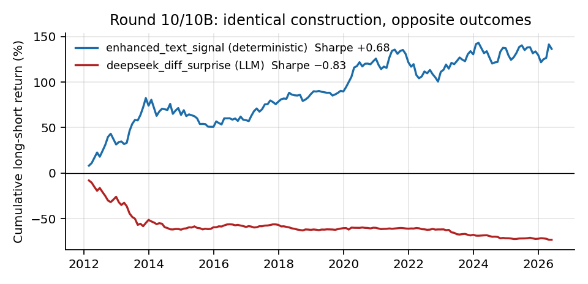
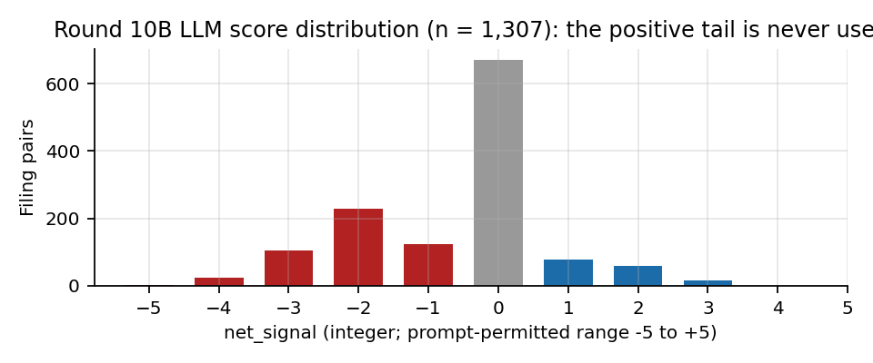
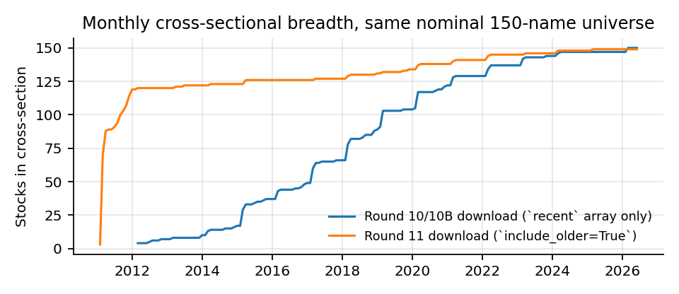

# LLM Equity Signal Research


**An end-to-end research pipeline that tests whether an LLM can read SEC annual-report
narratives and turn them into a cross-sectional equity signal — and a validation framework
strict enough to prove that it cannot.**

📄 **[Read the full 23-page report (PDF)](report/report.pdf)** · [LaTeX source](report/report.tex)

---

## TL;DR

- Built a **five-stage pipeline**: SEC ingestion → custom section parser → deterministic
  year-over-year diff → LLM extraction → sector-neutral long/short backtest with
  **three independent validity checks**.
- Scale: **150 US large caps, 2011–2026, 2,146 10-K filings, 1,307 LLM-scored filing pairs,
  185 monthly cross-sections.**
- Headline finding: at full statistical power the LLM signal is **significantly negative**
  (−0.83 Sharpe, FF3+MOM alpha −8.9%/yr, *t* = −2.54) and is beaten by a plain word-count
  dictionary on identical data. The failure mechanism is **identified**, not guessed:
  a structural negativity bias visible only in the aggregate score distribution.
- The deliverable is **not a profitable signal.** It is a reusable validation framework and
  the **round-by-round record of how it was built** — eleven rounds, each tightening one
  specific thing. Several of those tightenings moved the headline result by more than any
  prompt revision did.

---

## Why this project exists

Two literatures meet here and nobody had joined them under proper controls:

| Line | Established result |
|---|---|
| **Accounting** | Item 1A risk disclosure is firm-specific and informative (Campbell et al. 2014); *year-over-year changes* in filing language predict returns (Cohen–Malloy–Nguyen, *Lazy Prices*, 2020) |
| **LLM-in-finance** | LLMs extract tradable sentiment — but almost always from **timely** sources: news, earnings calls, financial statements |

The obvious intersection — *use an LLM to read what changed in a firm's risk narrative* — is
cheap to reach (free data, unambiguous filing-date anchor, a narrow well-posed question)
and had not been tested cross-sectionally with factor adjustment.

**This repo answers it.** The answer is no, and the value is in how cleanly that was established.

---

## Angle 1 — Investment / signal research

### Signal construction

| Family | What it is |
|---|---|
| **Deterministic lexicon** | Finance-specific word counts over Item 1A / MD&A, plus sector- and size-residualised variants. The benchmark the LLM has to beat. |
| **Similarity** | Lazy-Prices construction: rank by whole-document YoY similarity, long the high-similarity names. |
| **LLM diff-surprise** | Deterministic diff isolates what changed; the model scores only whether the change is investable. |

### Portfolio construction

**Sector-neutral rank-weighted long/short.** Within each sector, rank by signal, weight
proportional to demeaned rank, dollar-neutral book. Signals are stamped with the SEC
`filing_date` and forward-filled to month-ends — **point-in-time, never available before
the document was public.** Target is the 1-month-forward return.

Tie handling is fractional (early rounds broke ties by ticker alphabetical order, which
systematically overweighted names starting with "A" — see Round 5 below).

### The three-layer validity framework

This is the part that transfers to any new signal.

| Layer | Question it answers | Why it isn't enough alone |
|---|---|---|
| **500 persistent neutralised random baselines** | Is this distinguishable from luck? | A pure market-beta book is *also* non-random — it scores highly here while containing no alpha |
| **FF3 / FF5 + momentum regression**, Newey–West HAC (6 lags) | Is this alpha, or exposure to something already priced? | HAC lags are required: annual-filing signals hold ~12 months, so OLS errors understate and inflate *t* |
| **6× sample expansion** | Is this a small-sample artifact? | The decisive test — see below |

> **The gap between "p < 0.01 vs random" and "p ≈ 0.06 vs factors" is exactly the
> factor-explained portion of the return.** Both tests are needed; the factor test is stricter.

### Headline results

Identical construction, identical factor model, same universe:

| Signal | Sharpe | Cum. return | Rank IC | FF3+MOM alpha | vs 500 random |
|---|---:|---:|---:|---|---:|
| `deepseek_diff_surprise` (LLM, Item 1A) | **−0.83** | −73.4% | −0.040 | −8.94%/yr, *t* = −2.54, *p* = 0.012 | **0th pct** |
| `enhanced_text_signal` (lexicon, Item 1A) | **+0.68** | +136.5% | +0.033 | +5.11%/yr, *t* = 1.86, *p* = 0.065 | ~99th pct |
| `mdna_similarity` (Lazy Prices on MD&A) | **−0.72** | −41.6% | −0.007 | −3.64%/yr, *t* = −2.95, *p* = 0.004 | 0.4th pct |



**Three readings:**

1. **The LLM signal is anti-predictive, not merely uninformative.** Negative rank IC,
   significantly negative factor alpha, worse than *every one* of 500 random signals.
2. **One change revealed two truths at once.** Expanding from 42 to 150 names simultaneously
   exposed a genuinely negative LLM signal that had looked positive (+0.57 Sharpe,
   alpha *p* = 0.045 on the small sample) *and* a genuinely positive lexicon benchmark that
   had looked flat. The small sample was hiding both.
3. **The one signal that survives is honest about its size.** On full coverage the Item 1A
   lexicon gives 0.49 Sharpe, 95th percentile vs random, FF5+MOM alpha *t* = 2.12 — and it
   carries positive market beta, so part of the return is exposure, not alpha.

---

## Angle 2 — LLM engineering

### Architecture: the LLM on a short leash

```
[deterministic]  full filing → ~700-char blocks → Jaccard-match to last year's blocks
                 → send ONLY the changed text (≤12k chars); boilerplate never reaches the model
                               ↓
[LLM]            one judgement: does this change matter?   temp=0, JSON mode, schema-validated
                               ↓
[deterministic]  materiality gate re-checked in code → code (not the model) emits the number
```

**Design rule: anything doable with deterministic logic is not given to the LLM.** Every
responsibility handed to the model is reproducibility surrendered, so its uncertainty is
confined to one isolated, testable step.

### Prompt constraints — chosen to be *verifiable*, not aspirational

| Constraint | Failure it prevents | Verified outcome |
|---|---|---|
| **Evidence before score** — list ≤5 concrete changes with scope + direction + materiality 0–10, *then* aggregate | Reasoning-after-the-conclusion; untraceable positions | Every position traces to a cited change — this field is what made the error analysis possible |
| **Anonymisation** — no ticker, company name, or date anywhere; sector only | **Training-data contamination.** The model's training window covers the whole test period | Removes the "is it reading or remembering?" ambiguity |
| **No numeric exemplars** | Anchoring — an earlier prompt had **60% of outputs pinned to a single printed example value** | Anchor share → 0% |
| **Explicit base rate** — "risk sections grow through routine boilerplate; for most filings the correct answer is 0" | A model's urge to always find something | Zero-rate settled at a healthy 51–64% |
| **Materiality gate** — aggregate must be 0 without a company-specific change at materiality ≥ 6; **violations logged, not silently corrected** | Noise entering the book; unmeasurable compliance | **0 violations across 1,307 calls** |

### Why it still failed — the mechanism



Of 1,307 calls, 638 produced a non-zero score and **75.7% of those were negative**. More
diagnostic: the distribution is **asymmetric in range** — the model used its full negative
half down to −5 and **never exceeded +3**.

It equated *"this firm disclosed bad news"* with *"this firm will underperform"* — a correct
reading with an **incorrect causal direction**, since disclosure is often already priced and
resolution of uncertainty can itself be favourable.

> **This is invisible in any single output.** Every individual response was well-reasoned and
> defensible. The bias only exists in aggregate. **With no ground truth, the output
> distribution is your only quality check.**

### Cost discipline

- **Pilot gate** — 30 records against pre-defined distributional pass criteria with an
  automatic proceed / do-not-proceed decision. It caught a prompt whose distinct-value count
  had collapsed from 22 to 8, so **the full run was never paid for** — and it correctly
  diagnosed that the problem was *task design, not wording*.
- **Mock mode** — full pipeline development at zero API cost.
- **Atomic checkpointing** — temp file + rename, resumable.

---

## What each round changed

Each round exists to tighten **one specific thing**. More than half of them changed *how the
result was measured* rather than *what was measured* — which is why the headline number moves
as much as it does across the table.

| Round | What I changed | Why | What it bought |
|---|---|---|---|
| **1** | Lexicon baselines + 500-trial persistent random control + sector/size neutralisation | Nothing means anything without a reference distribution | 0.50 Sharpe at the 88.8th percentile — suggestive, **not significant**, and reported that way |
| **2** | Added LLM absolute severity scoring | Test whether semantics beat word counts | −0.51 Sharpe, worse than random — and the cause was identifiable: asking *"how severe are these risks"* inside a section legally required to enumerate risks **penalises thorough disclosure** |
| **3** | Switched to within-firm year-over-year comparison | Differences the disclosure-completeness confound away | 0.48 Sharpe on 169 rows — but prior-year context was incomplete |
| **4** | Completed the sample to 211 rows | Round 3's universe had gaps | **0.48 → 0.15 Sharpe.** First demonstration that adding data removes an apparent effect |
| **5** | **Audited the measurement. Changed no signal at all.** | If the ruler is biased, no comparison between rounds means anything | Fixed three *directional* biases: alphabetical tie-breaking, a random baseline redrawn monthly against a 12-month-holding strategy, and unneutralised LLM output. **Every prior round recomputed** |
| **6A** | Added a 30-row pilot gate before any full run | Outputs were clustering on the prompt's own printed example values | Anchors → 0%, but distinct values collapsed 22 → 8. **Gate said stop, so the full run was never paid for** — and it identified *task design*, not wording, as the real problem |
| **6B** | Redesigned the task: deterministic diff + "investable surprise" + materiality gate | Per-filing severity scoring was structurally confounded | Healthy zero-rate, **0 gate violations across the run**, every position traceable to a cited change |
| **6 review** | Moved the materiality gate from the prompt into the code | Code review: the assembly formula was adding a direction unconditionally | On **49/211 records** the model said *"no signal"* and the code supplied one anyway. Enforcing it: **0.33 → 0.43 Sharpe** |
| **7** | Rebuilt the Item 1A parser; re-ran everything; tested 4 portfolio constructions | A per-pair similarity metric flagged 12 pairs below 0.20 | **122/293 inputs had been the wrong text** — and the LLM returned well-formed JSON for all of them. Separately: **Sharpe 0.07 → 0.57 at constant rank IC**, purely from weighting |
| **8** | Added FF3/FF5 + momentum regression, Newey–West HAC | A random baseline cannot separate alpha from priced beta | "91st percentile vs random" narrowed to alpha *t* = 2.05 — marginal, post-hoc, on 42 names |
| **9** | Zero-API dry run at 150 names | Verify the pipeline scales *before* spending on it | Parser stable at scale (median similarity 0.78). The expensive step de-risked for free |
| **10 / 10B** | 6× the sample: 42 → 150 names, 70 → 172 months | Statistical power was the binding constraint — not the prompt | **One change revealed two truths at once**: a genuinely negative LLM signal that had looked positive, *and* a genuinely positive benchmark that had looked flat |
| **11** | Changed source to MD&A; **pre-registered H1/H2 before running**; repaired filing coverage | Test whether the *source* is the constraint, and stop selecting hypotheses after the fact | Coverage repair: 1,322 → **2,146 filings** (the 2012 cross-section had been **4 names**). H1 significant with reversed sign; H2 fails |



**One infrastructure change worth naming.** During the Round 10B extraction a long job was
killed mid-write and truncated its output — **~700 already-paid extractions lost.** The
checkpoint had been rewriting the entire file, including a full-text column, on every row, so
the write itself was the failure point. Moved to atomic write (temp file + rename) and dropped
the full-text column, shrinking the file ~100×. **A non-atomic checkpoint is not a checkpoint.**

> **The pattern across the table:** the three largest moves in the headline number came from
> the parser rebuild, the coverage repair, and the sample expansion — **not from any prompt
> revision.** Most LLM failures here were context and plumbing failures, not prompt failures.

---

## What transfers

1. **A model cannot tell you its input was bad.** You need a quality check that doesn't
   depend on the model, stored **per record**, not as an aggregate you glance at once.
2. **A rule in a prompt is a request; a rule in code is a control.** The model complied
   perfectly with a constraint the surrounding code then violated.
3. **Evaluate model output and the consumption layer separately** — an 8× Sharpe swing at
   constant rank IC belongs to the weighting scheme, not the model.
4. **With no ground truth, the distribution is the quality check.**
5. **Statistical power is a validity threat, not a nice-to-have.** The same expansion that
   falsified the LLM signal validated the benchmark.
6. **Knowing when to stop spending.** Six competing explanations were closed before
   concluding the source was the problem — which is what makes the conclusion load-bearing.

---

## Repository guide

| Path | Purpose |
|---|---|
| [`report/`](report) | **23-page PDF report + LaTeX source + figure-generation script** |
| [`src/data/`](src/data) | EDGAR download, Item 1A parser, MD&A extractor (Item 7 → in-report title → Exhibit 13) |
| [`src/features/`](src/features) | Lexicon signals, YoY diff engine, random baselines, sector/size neutralisation |
| [`src/llm/`](src/llm) | DeepSeek client, prompts, schemas, resumable extraction CLI |
| [`src/backtest/`](src/backtest) | Cross-sectional long/short construction and metrics |
| [`src/analysis/`](src/analysis) | Primary backtest, factor regression, Monte Carlo baselines, diagnostics |
| [`scripts/`](scripts) | One entry point per research round |
| [`lr/`](lr) | Literature review with verified sources, organised by *what text each study feeds the model* |
| [`signal_method.md`](signal_method.md) | Full round-by-round method log |

## Running it

```bash
python3 -m pip install -r requirements.txt
```

| Round | Command | API cost |
|---|---|---|
| 10 — deep deterministic backtest | `python3 scripts/run_round10_deep_backtest.py` | none |
| 10B — deep LLM backtest | `python3 scripts/run_round10b_llm_backtest.py` | 1,307 calls |
| 11 — MD&A source change | `python3 scripts/download_round11_mdna.py` then `run_round11_mdna_backtest.py` | none |
| Report figures | `python3 report/make_figures.py` | none |

Build the PDF with `cd report && tectonic -X compile report.tex` (or upload `report/` to Overleaf).
See [`signal_method.md`](signal_method.md) for the full round-by-round method log.

---

## Limitations

Stated plainly, because they bound what the results mean:

- **Survivorship/selection bias.** The universe is the alphabetically-first 150 *current*
  S&P 500 members. This is the most serious threat to interpreting any *positive* result —
  but since the bias inflates rather than suppresses performance, **the negative results are
  not weakened by it.**
- **Metadata is not point-in-time.** Sector and market-cap data are current.
- **Post-hoc construction choice.** Sector-neutral rank weighting was adopted after seeing
  Round 7 variant results.
- **Gross returns.** No transaction, borrowing, or capacity costs.
- **Single model family.** Whether the negativity bias generalises across providers is untested.

Research evidence only — not investment advice.

---

## Where it goes next

**Change the text source.** Both narrative sections inside the 10-K have now been tested and
neither carries a usable signal. The literature concentrates on timelier sources — earnings
calls, news, financial statements — and this project has never tested an LLM against one.
Two design choices follow directly from the failures above: **listwise ranking instead of
per-item scoring** (which cannot inherit a uniform negative tilt by construction), and
**the LLM as feature extractor rather than judge**.

A point-in-time universe including delisted firms is the gate before believing any *positive*
result — it becomes the first priority the moment one appears.

**What is explicitly not worth doing:** more prompt iteration on Item 1A diff-surprise.
The mechanism is structural, six alternative explanations are closed, and the result is
significantly negative at full power.
