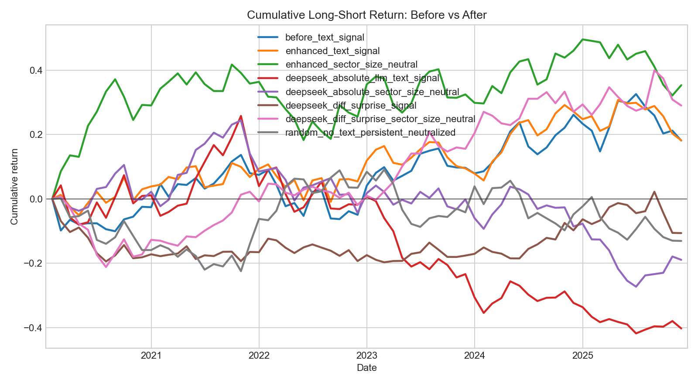

# LLM Equity Signal Research


Research prototype for testing whether SEC 10-K Item 1A Risk Factors can be converted into useful cross-sectional equity signals with deterministic text features and LLM-based extraction.

The project is deliberately built as a research pipeline rather than a trading system: text is aligned by filing date, converted into monthly point-in-time signals, evaluated against 1-month forward returns, and compared with random no-text baselines.

## What This Project Tests

Main research question:

```text
Can structured signals extracted from company risk disclosures forecast short-horizon relative stock returns?
```

The core workflow is:

```text
SEC 10-K Item 1A text
        -> deterministic or LLM-derived signal
        -> point-in-time monthly signal matrix
        -> cross-sectional long-short backtest
        -> IC, Sharpe, drawdown, cumulative return, random baseline comparison
```

The project has gone through six research rounds, from transparent dictionary signals to DeepSeek LLM prompts that score year-over-year filing changes.

## Current Status

Latest main result: **Round 6 diff-surprise LLM signal**.

- Universe: 211 SEC 10-K Item 1A filings, 42 large-cap US tickers.
- Filing window: 2020-2025 current filings, with prior 10-K context for YoY comparisons.
- Backtest: monthly signal alignment, 1-month forward returns, long top quintile / short bottom quintile.
- Latest evaluation: 71 common signal months, 70 backtest periods, fractional tie handling, persistent sector/size-neutralized random baseline.

The best overall signal is still the deterministic `enhanced_sector_size_neutral` signal. The best LLM signal is now much closer after the Round 6 redesign, but it still does not clear a 95% random-baseline significance threshold.

## Latest Results

Round 6 compares the latest diff-surprise LLM signal against deterministic baselines and older DeepSeek outputs on the same strict coverage.



| Signal | Ann. Return | Sharpe | Max DD | Mean IC | Final Cum |
|---|---:|---:|---:|---:|---:|
| `before_text_signal` | 2.89% | 0.28 | -17.54% | 2.48% | 18.10% |
| `enhanced_text_signal` | 2.90% | 0.30 | -10.84% | 2.67% | 18.17% |
| `enhanced_sector_size_neutral` | 5.32% | 0.48 | -16.55% | 2.00% | 35.30% |
| `deepseek_absolute_llm_text_signal` | -8.45% | -0.47 | -53.72% | -2.15% | -40.25% |
| `deepseek_absolute_sector_size_neutral` | -3.53% | -0.20 | -41.53% | 0.95% | -18.94% |
| `deepseek_diff_surprise_signal` | -1.91% | -0.14 | -13.76% | -0.92% | -10.64% |
| `deepseek_diff_surprise_sector_size_neutral` | 4.46% | 0.43 | -21.73% | 0.59% | 28.98% |
| `random_no_text_persistent_neutralized` | -2.37% | -0.10 | -22.58% | -0.86% | -13.07% |

Round 6 neutralized diff-surprise LLM signal versus 500 persistent neutralized random trials:

| Metric | Strategy | Random p95 | Percentile | Empirical p-value |
|---|---:|---:|---:|---:|
| Annualized return | 4.46% | 9.11% | 82.2% | 17.8% |
| Sharpe ratio | 0.43 | 0.75 | 84.6% | 15.4% |
| Mean IC | 0.59% | 3.49% | 62.0% | 38.0% |
| Mean rank IC | 1.74% | 3.56% | 77.6% | 22.4% |
| Final cumulative return | 28.98% | 66.34% | 82.2% | 17.8% |

Interpretation: Round 6 is the strongest LLM result so far, but it is still **promising rather than robust**. The full-output diagnostic still flags coarse nonzero score buckets, so the next research step should improve signal granularity and increase statistical power.

## Research Rounds

| Round | Method | Main Result | Takeaway |
|---|---|---:|---|
| 1 | Deterministic dictionary signals | `enhanced_sector_size_neutral`: 5.92% ann. return, 0.50 Sharpe, 39.89% final cum | Transparent text features beat most random baselines, but not at 95% significance. |
| 2 | DeepSeek absolute LLM signal | `deepseek_llm_text_signal`: -9.11% ann. return, -0.51 Sharpe, -42.73% final cum | Absolute risk-severity scoring performs poorly on risk-factor text. |
| 3 | Initial YoY relative LLM signal | 5.56% ann. return, 0.48 Sharpe on 169 rows / 40 tickers | Looked promising, but sample was incomplete because prior context was missing. |
| 4 | Full YoY relative LLM signal | 1.09% ann. return, 0.15 Sharpe, 6.55% final cum | Performance dropped after completing the 211-row universe. |
| 5 | Soundness fix: fractional ties, persistent random, LLM neutralization | Best overall remained `enhanced_sector_size_neutral`: 5.32% ann. return, 0.48 Sharpe | Evaluation became cleaner; old neutralized YoY LLM remained weak at 0.10 Sharpe. |
| 6 | Diff-surprise LLM prompt on deterministic YoY diffs | `deepseek_diff_surprise_sector_size_neutral`: 4.46% ann. return, 0.43 Sharpe, 28.98% final cum | Best LLM signal so far; close to deterministic baseline but not statistically robust yet. |

Detailed method notes and round-by-round interpretation are in [`signal_method.md`](signal_method.md).

## Method Summary

The project currently compares four broad signal families:

- **Deterministic dictionary signals**: transparent lexicon-based scores from Item 1A text.
- **Sector/size-neutral deterministic signals**: residualized text signals after removing sector and market-cap exposure.
- **Absolute LLM signals**: DeepSeek scores each filing independently from risk-factor text.
- **YoY LLM signals**: DeepSeek scores changes between current and prior filings, with Round 6 using a deterministic diff first and asking only for company-specific investable surprise.

The latest LLM design is intentionally conservative:

- The model sees changed sections instead of two clipped raw filings.
- The prompt asks for material company-specific changes, not generic risk severity.
- Market-wide and sector-wide language is diagnostic only.
- Most filings are expected to receive a zero `net_signal`.
- `net_signal = 0` rows stay exactly zero in the final composite signal.

## Repository Guide

| Path | Purpose |
|---|---|
| [`src/data/`](src/data) | Price, SEC filing, text, and metadata loading/downloading. |
| [`src/features/`](src/features) | Deterministic text signals, random baselines, sector/size neutralization, risk-section diffs. |
| [`src/llm/`](src/llm) | DeepSeek clients, prompts, schemas, and extraction pipelines. |
| [`src/backtest/`](src/backtest) | Cross-sectional long-short portfolio construction and metrics. |
| [`src/analysis/`](src/analysis) | Strategy comparison, Monte Carlo baselines, diagnostics, and plots. |
| [`scripts/`](scripts) | CLI entry points for data download, LLM extraction, and research rounds. |
| [`reports/`](reports) | Round-specific metrics, IC files, cumulative return charts, diagnostics, and comparison reports. |

Start with these documents:

- [`progress.md`](progress.md): current project status and next steps.
- [`signal_method.md`](signal_method.md): method details, prompt evolution, and round-by-round results.
- [`code_map.md`](code_map.md): where each script lives and how to run/reproduce each round.

## How To Run

Detailed commands live in [`code_map.md`](code_map.md). That file is the source of truth for:

- downloading current and prior SEC filings;
- refreshing ticker metadata;
- running deterministic baselines;
- running DeepSeek extraction workflows;
- reproducing Round 4, Round 5, and Round 6 comparisons.

The short version is:

```bash
python3 -m pip install -r requirements.txt
```

Then follow the relevant section in [`code_map.md`](code_map.md), depending on whether you want to reproduce existing reports or make new DeepSeek API calls.

## Current Limitations

- The universe is small: 42 tickers is not enough to draw strong statistical conclusions.
- Metadata for sector and market cap is current static metadata, not point-in-time historical metadata.
- SEC Item 1A extraction quality still matters; low-similarity YoY pairs need manual audit.
- The latest LLM signal still clusters committed nonzero scores into coarse buckets.
- Results are research evidence only and should not be treated as investment advice.

## Next Research Steps

1. Expand to a larger point-in-time universe, ideally S&P 500-scale.
2. Audit low-similarity YoY filing pairs and fix SEC extraction edge cases.
3. Test listwise sector/year ranking prompts to produce direct cross-sectional ordering.
4. Improve score granularity for committed nonzero LLM signals.
5. Add higher-frequency text sources such as earnings calls or 8-Ks.
